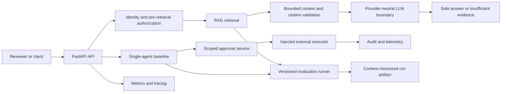
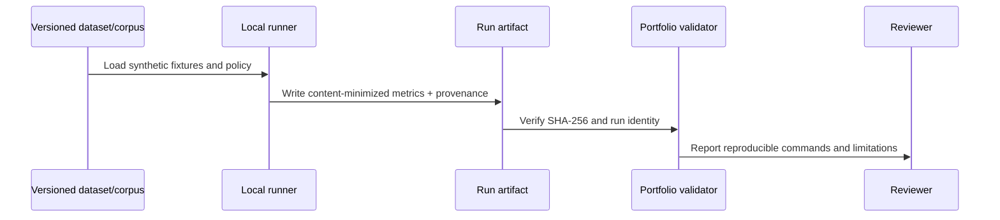
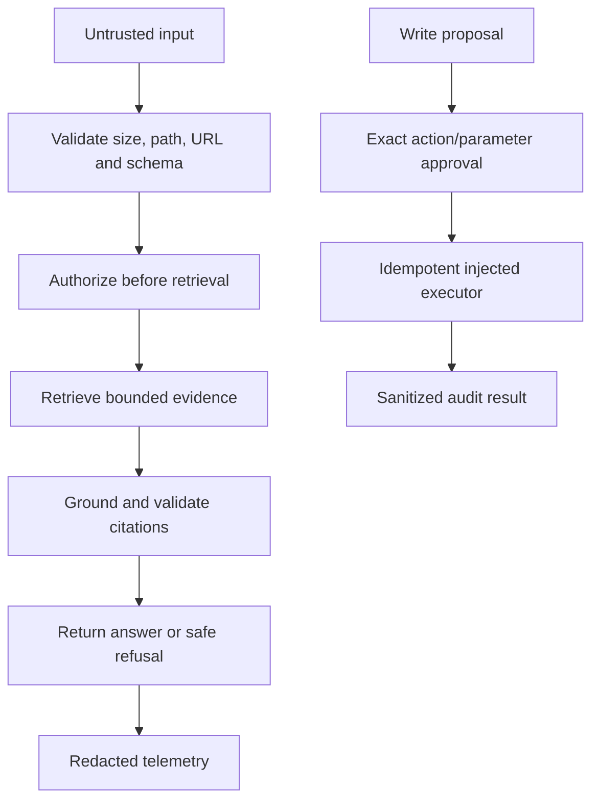

# EKAA Architecture and System Diagrams

## System boundary

The arrows express dependency direction, not a claim that every edge is enabled in
the default local process. Authorization is applied before protected retrieval;
retrieved text, prompts, and tool output remain untrusted data. External writes are
impossible without scoped human approval and are not exercised by the portfolio demo.

## Evaluation/release evidence flow

## Runtime safety boundaries

